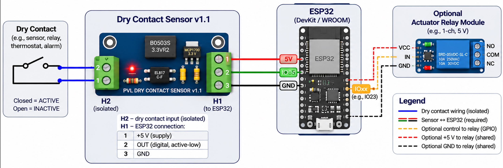
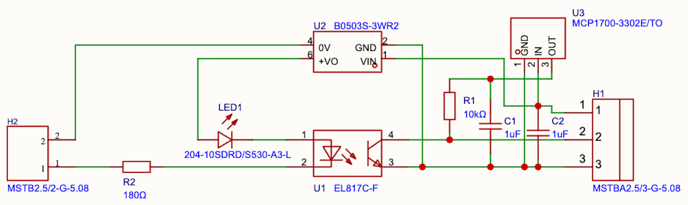
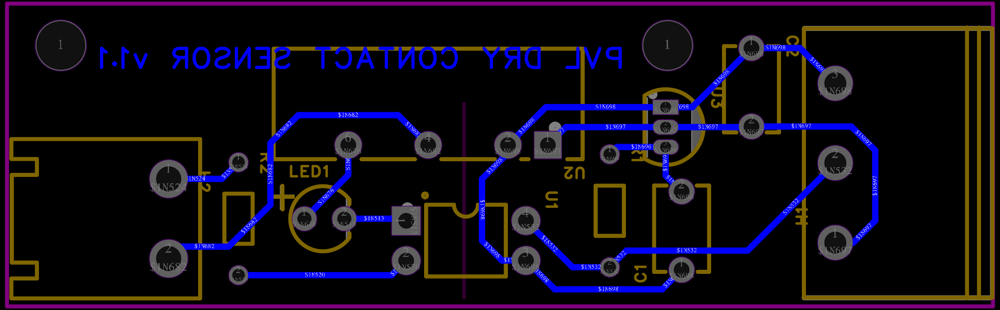

# ESPDryContactSensor

## Overview
A compact, optically isolated dry-contact sensor for ESP32 and other 3.3 V microcontrollers, with an onboard regulator, isolated DC-DC converter and active-low digital output.

[](images/wiring/wiring-diagram.jpeg)

## Features
* 5 V supply
* galvanic isolation
* status LED
* removable 5.08 mm terminal blocks
* (potentially) DIN-rail adapter mounting.

## Application
Use the board to monitor potential-free (dry) contacts with an ESP32 or another 3.3 V microcontroller. Galvanic isolation separates the contact circuit from the microcontroller, making the board suitable for integrating contact-based sensors and switches into monitoring and automation systems.

Typical applications include:

* Reading potential-free relay contacts from external equipment.
* Connecting to boiler relay of the heating system (e.g., Danfoss Link) to receive enable command.
* Detecting push-button or mechanical switch operation.
* Door and window monitoring with reed switches.
* Equipment position detection with limit switches.

## Connecting and Wiring

### Using the board
The board is powered by 5 VDC. Connect the potential-free contact to the sensor input, and connect the digital output to a microcontroller GPIO with a common ground on the microcontroller side. The active-low output reads LOW when the contact is closed and HIGH when it is open. Use the microcontroller firmware to interpret these states and debounce mechanical contacts as needed.

**Wiring schema (example)**
```
+-----------------------+-------------+-------------------------+
| Dry Contact Board Pin | ESP32 Pin   | Comment                 |
+-----------------------+-------------+-------------------------+
| H1 - 1                | +5 V        | Board power supply      |
+-----------------------+-------------+-------------------------+
| H1 - 2                | IO05        | Digital state input     |
+-----------------------+-------------+-------------------------+
| H1 - 3                | GND         | Ground                  |
+-----------------------+-------------+-------------------------+
| H2 - 1                | N/A         | Connect to two contacts,|
+-----------------------|             | aimed to be closed. E.g.|
| H2 - 2                |             | button, switch or relay |
+-----------------------+-------------+-------------------------+
```
> [!WARNING]
> The input is intended only for potential-free contacts; do not connect externally powered signals or mains voltage, otherwise you will damage the board or will mulfunction.

## Technical Specifications

### General

| Parameter | Specification |
|---|---|
| Device | Dry Contact Sensor |
| Hardware revision | v1.1 |
| Input type | Potential-free (dry) contact, normally open or normally closed |
| Supply voltage | 5 V DC nominal |
| Supply current | TBD — to be measured |
| Logic interface | 3.3 V digital output, active LOW |
| Output type | Optocoupler phototransistor, open collector with onboard 10 kΩ pull-up |
| Output HIGH | Approximately 3.3 V (contact open) |
| Output LOW | Approximately 0 V (contact closed) |
| Status indication | Red LED illuminated when contact is closed |
| Input connector | 2-pin, 5.08 mm pitch, pluggable terminal block |
| ESP32 connector | 3-pin, 5.08 mm pitch, pluggable terminal block |
| Mounting | Two mounting holes, 38 mm center-to-center, for compatible DIN-rail adapter |
| Operating temperature | TBD |
| PCB dimensions | TBD |

### Electrical Isolation

| Parameter | Specification |
|---|---|
| Signal isolation | EL817C-F optocoupler |
| Optocoupler isolation withstand | 5,000 V AC RMS, 1 minute (component rating) |
| Power isolation | B0503S-3WR2 isolated DC-DC converter |
| DC-DC isolation withstand | 1,500 V DC, 1 minute (component rating; subject to exact manufacturer datasheet) |
| Isolated supply output | 3.3 V DC nominal, unregulated |
| Galvanic separation | Dry-contact circuit isolated from ESP32 power and GPIO |
| Board-level isolation certification | Not certified |

**Note:** Component isolation withstand ratings do not constitute an isolation certification for the assembled board. Actual insulation performance depends on PCB creepage, clearance, layout and manufacturing conditions.

### Operating Principle

The sensor uses an isolated DC-DC converter to power a low-voltage sensing circuit that is galvanically separated from the host microcontroller.

When an external dry contact closes, current flows through the status LED and the optocoupler input LED. The optocoupler phototransistor switches on and pulls the digital output LOW (approximately 0 V).

When the contact opens, the optocoupler switches off and the onboard 10 kΩ pull-up resistor restores the output to approximately 3.3 V (HIGH).

An MCP1700 linear regulator provides a dedicated 3.3 V supply for the output pull-up, allowing the sensor to operate from a standard 5 V supply while maintaining compatibility with ESP32 GPIO inputs.

The external dry-contact circuit requires no shared ground connection with the ESP32. The H2 terminals are intended exclusively for potential-free contacts and must not receive an external voltage.

## Assembly

The Dry Contact Sensor is designed using commonly available through-hole (THT) components, making it suitable for manual assembly without specialized soldering equipment.

There are two ways to build the sensor, depending on your preferences and available tools.

### Option 1: Build on a Universal Prototyping PCB

You can assemble the entire circuit manually using a standard universal prototyping PCB (perfboard or stripboard).

This option is suitable for experimenting with the circuit, building a single unit, or modifying the original design.

**Required components (per sensor):**

| Component | Part Number / Specification | Quantity |
|---|---|---:|
| Optocoupler | EL817C-F, DIP-4 | 1 |
| Isolated DC-DC converter | B0503S-3WR2, 5 V to 3.3 V | 1 |
| Voltage regulator | MCP1700-3302E/TO, 3.3 V, TO-92 | 1 |
| LED | 204-10SDRD/S530-A3-L, red | 1 |
| Resistor | 10 kΩ | 1 |
| Resistor | 180 Ω | 1 |
| Capacitor | 1 µF, ceramic | 2 |
| Input connector | 2-pin screw terminal or equivalent | 1 |
| Power/output connector | 3-pin screw terminal or equivalent | 1 |
| Universal PCB | Perfboard or stripboard | 1 |

Additional materials include insulated hookup wire and soldering supplies.

Refer to the [electrical schematic](hardware/documentation/DryContactSensor_schematic.pdf) when assembling the circuit.
[](images/v1.1/Schematic_v1.1.png)

**Important:** Maintain adequate physical separation between the isolated dry-contact circuitry and the ESP32-side circuitry. Avoid creating unintended electrical connections across the isolation boundary.

### Option 2: Order a Professionally Manufactured PCB (Recommended)

For a cleaner, more reliable, and repeatable assembly, you can order a custom PCB using the manufacturing files provided in this repository.

The PCB can be manufactured by [JLCPCB](https://jlcpcb.com/) or another PCB fabrication service.

**Manufacturing steps:**

1. Download the [Gerber files](hardware/manufacturing/Gerber_DryContactSensor_PCB_v1.1.zip).
2. Open your preferred PCB manufacturer's website and upload the Gerber ZIP file.
3. Review the automatically detected PCB dimensions and manufacturing parameters.
4. Order the required number of bare PCBs.
5. Once the boards arrive, manually solder the components following the PCB silkscreen and schematic.
6. Inspect solder joints and verify component polarity and orientation before applying power.

All components are through-hole, so no reflow soldering or SMD assembly equipment is necessary.

The editable [EasyEDA Pro project](hardware/easyeda/DryContactSensor_project.epro2) is also available if you want to modify the PCB design before manufacturing.

**PCB preview:**



### Initial Testing

Before connecting the sensor to an ESP32 or another microcontroller:

1. Inspect the assembled board for solder bridges, incorrect component orientation, and shorts.
2. Apply a regulated 5 V DC supply to the power connector.
3. Verify that the onboard regulator provides approximately 3.3 V.
4. With the dry-contact input open, verify that the digital output is HIGH (approximately 3.3 V).
5. Short the two dry-contact terminals using a jumper wire or mechanical switch.
6. Verify that the status LED illuminates and the digital output transitions LOW (approximately 0 V).
7. Remove the jumper and confirm that the output returns HIGH.

Once these checks pass, the sensor can be connected to the microcontroller according to the wiring diagram.

**Safety:** The dry-contact input is designed for potential-free contacts only. Never connect an external voltage source, including mains voltage, to the input terminals.

## Using with ESP32

The Dry Contact Sensor is designed to interface directly with an ESP32 GPIO input using **3.3 V digital logic**.

Connect the sensor's `OUT` terminal to an ESP32 GPIO pin (e.g., `GPIO5`), along with the required `+5V` and `GND` connections, as shown in the [wiring diagram](images/wiring/wiring-diagram.jpeg).

The sensor provides an **active-LOW output**:

- **LOW (0):** Dry contact is closed.
- **HIGH (1):** Dry contact is open.

The sensor includes an onboard 10 kΩ pull-up resistor, so the ESP32's internal pull-up is not required.

### Reading GPIO State (Polling)

The simplest way to determine the contact state is to read the GPIO level directly using the ESP-IDF `gpio_get_level()` function:

```c
int level = gpio_get_level(GPIO_NUM_5);
bool contact_closed = (level == 0);
```

This approach is suitable for applications where the contact state is checked periodically or when immediate reaction to changes is not required.

The GPIO must first be configured as a digital input.

### Interrupt-Driven State Detection

For applications requiring immediate notification when a contact changes state, an **interrupt-driven approach** is recommended.

ESP-IDF supports GPIO interrupts on rising edges, falling edges, or both. By configuring an interrupt on both edges (`GPIO_INTR_ANYEDGE`), the application can detect contact opening and closing without continuously polling the GPIO.

A recommended implementation is to keep the Interrupt Service Routine (ISR) as short as possible and delegate event processing to a dedicated FreeRTOS task using a queue.

The following example demonstrates this approach.

**GPIO event structure and queue:**

```c
typedef struct {
    int gpio_num;
    int level;
} gpio_event_t;

static QueueHandle_t gpio_evt_queue = NULL;
```

**GPIO interrupt handler:**

```c
/**
 * @brief GPIO interrupt service routine (ISR) handler.
 *
 * This ISR is triggered when a GPIO interrupt occurs. It reads
 * the GPIO pin state and sends an event to a FreeRTOS queue for
 * further processing by a dedicated task.
 *
 * @param[in] arg GPIO pin number passed as an ISR argument.
 */
void IRAM_ATTR gpio_isr_handler(void *arg) {
    int gpio_num = (int)(intptr_t)arg;
    gpio_event_t evt;

    evt.gpio_num = gpio_num;
    evt.level = gpio_get_level(gpio_num);

    BaseType_t xHigherPriorityTaskWoken = pdFALSE;

    if (gpio_evt_queue != NULL) {
        xQueueSendFromISR(
            gpio_evt_queue,
            &evt,
            &xHigherPriorityTaskWoken
        );
    }

    // Perform a context switch if necessary
    if (xHigherPriorityTaskWoken == pdTRUE) {
        portYIELD_FROM_ISR();
    }
}
```

**GPIO initialization:**

```c
#define SENSOR_GPIO GPIO_NUM_5

gpio_config_t io_conf = {
    .pin_bit_mask = (1ULL << SENSOR_GPIO),
    .mode = GPIO_MODE_INPUT,
    .pull_up_en = GPIO_PULLUP_DISABLE,
    .pull_down_en = GPIO_PULLDOWN_DISABLE,
    .intr_type = GPIO_INTR_ANYEDGE
};

gpio_config(&io_conf);

// Create the event queue before enabling the ISR
gpio_evt_queue = xQueueCreate(10, sizeof(gpio_event_t));

// Install and register the GPIO ISR
gpio_install_isr_service(0);
gpio_isr_handler_add(
    SENSOR_GPIO,
    gpio_isr_handler,
    (void *)(intptr_t)SENSOR_GPIO
);
```

This example assumes that the FreeRTOS queue and ISR service have not already been initialized elsewhere. In a larger application, the ISR service should be installed only once. Production code should also check the return values of the initialization functions.

**Processing GPIO events:**

A dedicated FreeRTOS task can receive events from the queue and perform the required application logic:

```c
void gpio_event_task(void *arg) {
    gpio_event_t evt;

    while (true) {
        if (xQueueReceive(
                gpio_evt_queue,
                &evt,
                portMAX_DELAY
            ) == pdTRUE) {

            bool contact_closed = (evt.level == 0);

            // Process the contact state here
        }
    }
}
```

This architecture keeps the ISR lightweight while allowing more complex operations, such as MQTT publishing, Home Assistant state updates, or relay control, to execute safely in task context.

**Note:** The ISR example assumes that the interrupt handler is installed with the ESP-IDF default ISR service configuration. The required ESP-IDF and FreeRTOS headers must be included in the application.

### Contact Debouncing

Mechanical switches and relay contacts may produce multiple rapid transitions when opening or closing due to **contact bounce**.

Depending on the application, it may be useful to implement software debouncing to prevent multiple events from being interpreted as separate state changes.

Common approaches include:

- Ignoring repeated transitions within a configurable time interval (e.g., 20–50 ms).
- Using a FreeRTOS timer to verify that the GPIO state remains stable before processing it.
- Periodically sampling the GPIO state and accepting changes only after several consistent readings.

For interrupt-driven applications, debouncing should preferably be implemented in the event-processing task rather than inside the ISR.

For critical state tracking, consider reading the current GPIO level again after the debounce interval instead of relying solely on the level captured during the initial interrupt.

### Integration with ESPRelayBoard

This Dry Contact Sensor was specifically designed to work with the open-source [ESPRelayBoard](https://github.com/rpavlyuk/ESPRelayBoard) project.

ESPRelayBoard is an ESP32-based relay control solution that supports GPIO monitoring, MQTT communication, Home Assistant integration, and automation logic.

When connected to ESPRelayBoard, the Dry Contact Sensor provides a galvanically isolated way to monitor external potential-free contacts, such as:

- Boiler and heating controller relay contacts.
- Auxiliary contacts from industrial relays and contactors.
- Mechanical switches and other dry-contact signaling devices.

The sensor can be used to detect external equipment states and make them available to ESPRelayBoard's automation and monitoring functions.

Although designed with ESPRelayBoard in mind, the sensor is not limited to this project and can be used with other ESP32-based or 3.3 V-compatible microcontroller applications.

## License & Credits

### License

This project is open-source hardware licensed under the [CERN Open Hardware Licence Version 2 — Weakly Reciprocal (CERN-OHL-W-2.0)](https://gitlab.com/ohwr/project/cernohl/-/wikis/Documents/CERN-OHL-version-2).

You are free to use, manufacture, modify, distribute, and commercially exploit this hardware design under the terms of the license.

If you modify and distribute the hardware design or products based on it, you must comply with the license's source-sharing and attribution requirements, including making the applicable modified design sources available.

See the [LICENSE](LICENSE) file for the complete license terms.

### Credits

**Designed and developed by Roman Pavlyuk.**

Project source code and hardware design files are available on GitHub.

Copyright © 2026 Roman Pavlyuk.

### Disclaimer

This project is provided **"AS IS"**, without warranty of any kind, express or implied.

The hardware is intended for low-voltage dry-contact sensing applications. It has not been independently certified for electrical safety or compliance with industrial standards.

Users are responsible for ensuring that their implementation is appropriate for the intended application and complies with applicable electrical safety requirements.